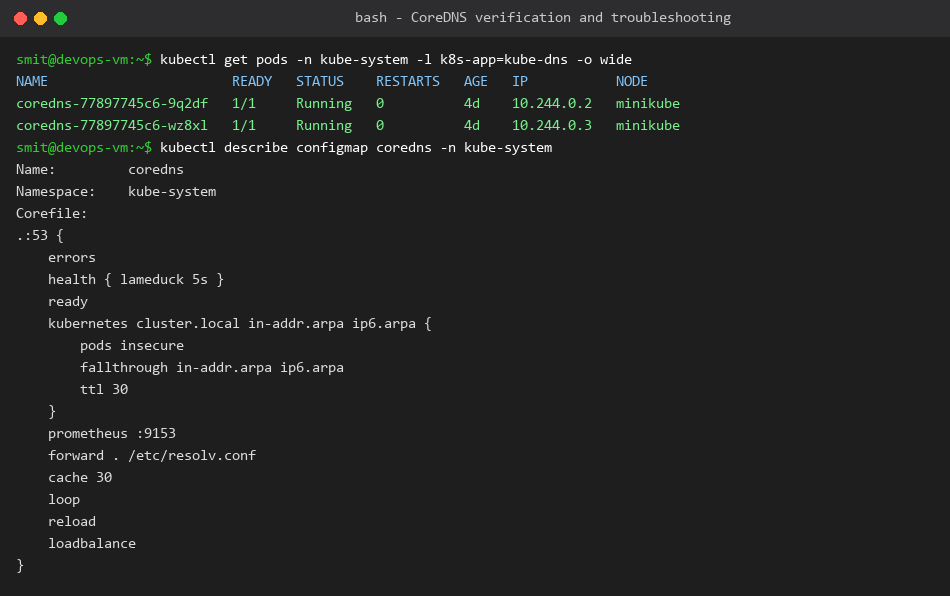

# CoreDNS in Kubernetes

**Name:** Smit Rupani  
**Enrollment:** 24bcs10256  

---

## 1. What is CoreDNS?
CoreDNS is a flexible, extensible DNS server written in Go. In modern Kubernetes clusters, CoreDNS is the default cluster DNS provider installed as a deployment in `kube-system`.

## 2. Why Kubernetes Uses CoreDNS
- Replaced kube-dns due to fewer containers, lower memory overhead, and higher performance.
- Pluggable architecture allowing easy integration with Kubernetes API endpoints, Prometheus metrics, caching, and custom upstreams.

## 3. How Service Discovery Works
1. When a Service is created, the Kubernetes API server notifies the endpoints controller.
2. The CoreDNS `kubernetes` plugin continuously watches the Kubernetes API for new Services and Endpoints.
3. CoreDNS dynamically maps the Service names and headless Pod records into internal DNS records.

## 4. How DNS Queries are Resolved
- **Cluster Queries:** `*.cluster.local` are answered directly by CoreDNS using in-memory caches populated from Kubernetes API.
- **External Queries:** Non-cluster queries (e.g. `google.com`) fall through the forward plugin and are passed to upstream resolvers configured in `/etc/resolv.conf`.

## 5. CoreDNS Configuration (`Corefile`)
CoreDNS is configured via a ConfigMap named `coredns` in the `kube-system` namespace.
Key directives include:
- `errors`: Logs errors to standard output.
- `health`: Provides liveness endpoint on `:8080/health`.
- `kubernetes cluster.local`: Serves DNS for the `cluster.local` top-level domain.
- `forward . /etc/resolv.conf`: Forwards non-Kubernetes queries to host resolvers.
- `cache 30`: Caches responses for up to 30 seconds to reduce lookup latency.

## 6. How to Troubleshoot DNS Issues
1. **Check CoreDNS Pod status:**
   ```bash
   kubectl get pods -n kube-system -l k8s-app=kube-dns
   ```
2. **Inspect CoreDNS logs:**
   ```bash
   kubectl logs -n kube-system -l k8s-app=kube-dns
   ```
3. **Check Service and Endpoints:**
   ```bash
   kubectl get svc <service-name>
   kubectl get endpoints <service-name>
   ```
4. **Test lookup from within a test container:**
   ```bash
   kubectl run test-dns --image=busybox:1.28 -it --rm -- nslookup <service-name>
   ```

## 7. Output & Verification

