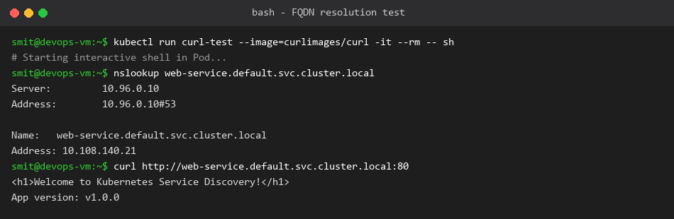

# Fully Qualified Domain Name (FQDN) in Kubernetes

**Name:** Smit Rupani  
**Enrollment:** 24bcs10256  

---

## 1. What is an FQDN?
An **FQDN (Fully Qualified Domain Name)** is the complete, unambiguous domain name specifying an exact location in the Domain Name System (DNS) hierarchy down to the root domain.

## 2. Kubernetes Service DNS
In Kubernetes, every Service is assigned a cluster-internal DNS record managed by CoreDNS.
Pods can resolve Services using either short names or full FQDNs.

## 3. Kubernetes DNS Naming Convention
The standard format for a Service FQDN is:
```
<service-name>.<namespace>.svc.<cluster-domain>
```
- `<service-name>`: Name of your Service object (e.g., `web-service`)
- `<namespace>`: Namespace where the Service lives (e.g., `default`, `prod`)
- `svc`: Indicates this record is a Kubernetes Service
- `<cluster-domain>`: Internal cluster suffix (default: `cluster.local`)

## 4. Namespace-Based DNS Resolution
- **Same Namespace:** A Pod in `default` can reach `web-service` just by typing `curl http://web-service:80`
- **Across Namespaces:** A Pod in namespace `analytics` reaching a Service in `payments` must specify:
  ```
  payments-service.payments.svc.cluster.local
  ```
  or shorthand:
  ```
  payments-service.payments
  ```

## 5. Pod-to-Service Communication Flow
1. Pod sends DNS request for `web-service.default.svc.cluster.local`.
2. CoreDNS resolves query to ClusterIP (e.g. `10.108.140.21`).
3. Pod initiates TCP connection to `10.108.140.21:80`.
4. `kube-proxy` (via iptables/IPVS) translates ClusterIP to one of the healthy Pod IP endpoints.

## 6. Output & Verification

