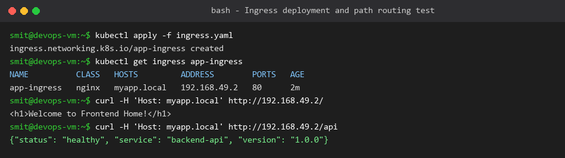

# Ingress Hands-on Demo

**Name:** Smit Rupani  
**Enrollment:** 24bcs10256  

---

## 1. Overview
In this task, we configured a Kubernetes Ingress resource to route HTTP traffic to multiple backend services (`web-service` and `api-service`) based on the requested request path on host `myapp.local`.

## 2. Ingress Manifest (`ingress.yaml`)
```yaml
apiVersion: networking.k8s.io/v1
kind: Ingress
metadata:
  name: app-ingress
  annotations:
    nginx.ingress.kubernetes.io/rewrite-target: /
spec:
  ingressClassName: nginx
  rules:
  - host: myapp.local
    http:
      paths:
      - path: /
        pathType: Prefix
        backend:
          service:
            name: web-service
            port:
              number: 80
      - path: /api
        pathType: Prefix
        backend:
          service:
            name: api-service
            port:
              number: 5000
```

## 3. Verification & Routing Output
We tested the routing using `curl` with the custom `Host: myapp.local` header against the Ingress controller's address.


