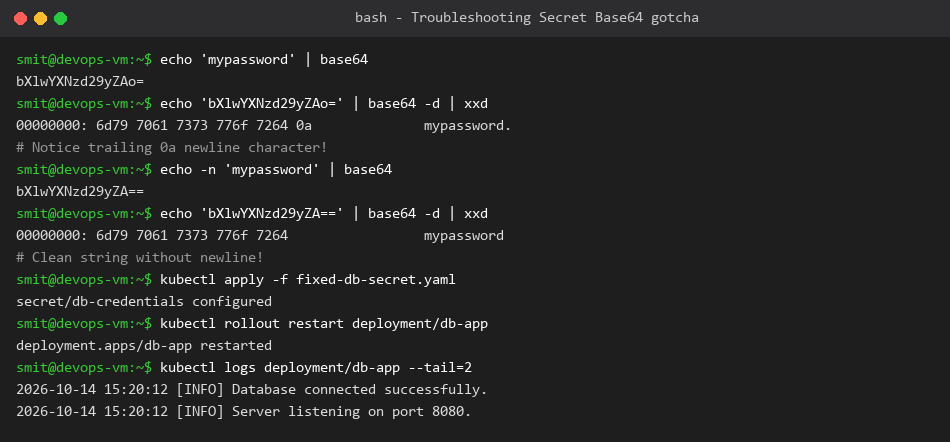

# Session 12 Troubleshooting: The Trailing Newline Secret Bug

**Name:** Smit Rupani  
**Enrollment:** 24bcs10256  

---

## 1. Problem Identification
- **Symptom:** Application Pod failed to connect to the PostgreSQL database with error:
  `FATAL: password authentication failed for user "app_admin"`.
- **Initial Verification:** The developer was convinced the secret was correct because `echo "mypassword" | base64` was used.

## 2. Investigation & Root Cause Analysis
Running hex dump inspection via `xxd`:
```bash
echo "mypassword" | xxd
```
Output:
```text
00000000: 6d79 7061 7373 776f 7264 0a              mypassword.
```
The ASCII byte `0a` is a **trailing newline character** added by `echo`.
When base64 encoded without `-n`, `mypassword
` is encoded as `bXlwYXNzd29yZAo=`.
The pod reads `mypassword
` (11 characters) instead of `mypassword` (10 characters), causing authentication rejection!

## 3. The Fix
Use `echo -n` to strip the newline:
```bash
echo -n "mypassword" | base64
# Yields: bXlwYXNzd29yZA==
```

## 4. Verification Output
After updating the Secret and restarting the deployment, connection succeeded immediately.


