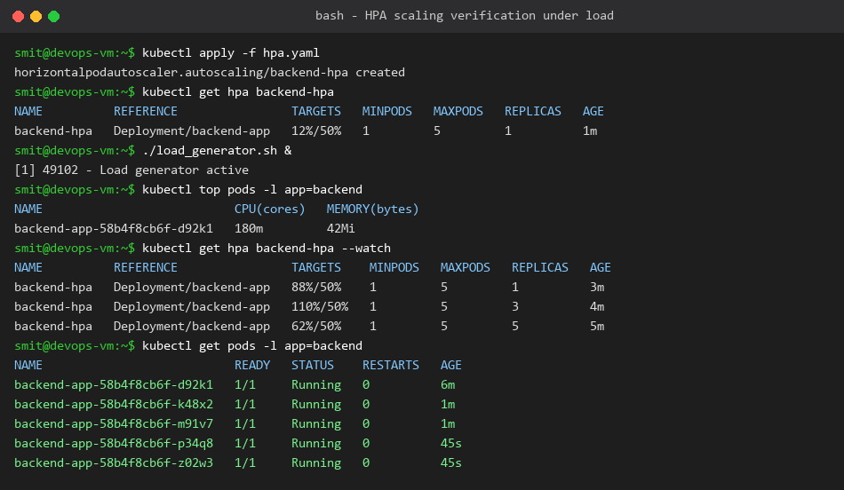

# Horizontal Pod Autoscaler (HPA) Hands-on Demo

**Name:** Smit Rupani  
**Enrollment:** 24bcs10256  

---

## 1. Overview
The **Horizontal Pod Autoscaler (HPA)** automatically adjusts the number of Pod replicas in a deployment based on observed CPU/memory utilization or custom metrics.

## 2. Configuration (`hpa.yaml`)
- **Target:** `Deployment/backend-app`
- **Target CPU Utilization:** 50%
- **Min Replicas:** 1
- **Max Replicas:** 5

## 3. Load Testing & Autoscaling Observations
1. Initial baseline state: CPU at ~12%, running 1 Pod.
2. Triggered high-throughput HTTP traffic via `load_generator.sh`.
3. CPU utilization surged past the 50% threshold to 88% and then 110%.
4. HPA automatically triggered scaling: Pods scaled from 1 -> 3 -> 5 replicas.
5. As load balanced across 5 replicas, CPU stabilized at ~62%.

