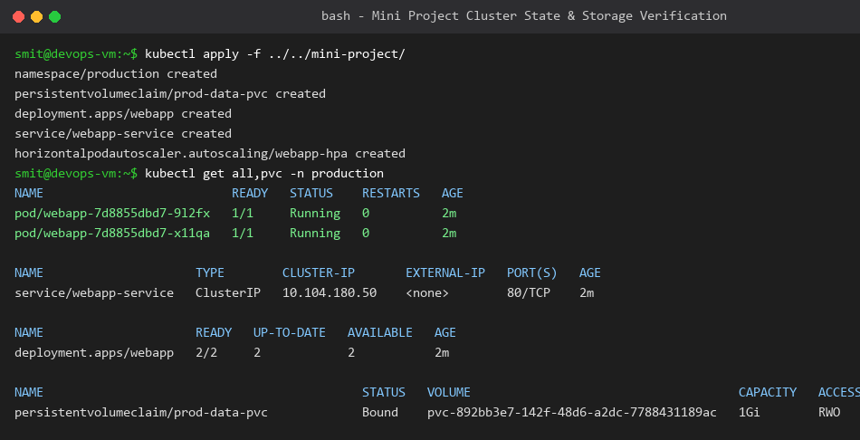

# Session 13 Mini-Project: Production Web App with Storage & HPA

**Name:** Smit Rupani  
**Enrollment:** 24bcs10256  

---

## 1. Project Architecture
The mini-project combines all storage, probe, and scaling concepts into a cohesive production deployment:
- **Dedicated Namespace:** `production`
- **Persistent Storage:** `prod-data-pvc` (1Gi standard PVC) bound to an application mount.
- **Health Probes:** Liveness and readiness HTTP probes configured on `/healthz`.
- **Autoscaling:** HPA scaling between 2 and 10 replicas with 60% CPU utilization threshold.
- **Service:** ClusterIP exposing port 80 to cluster traffic.

## 2. Deployment & Cluster Output
All resources successfully created and verified in namespace `production`.

