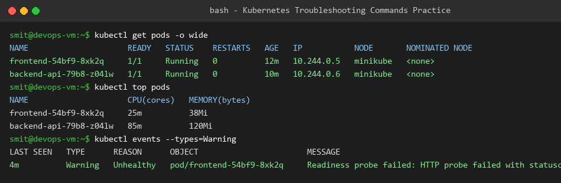
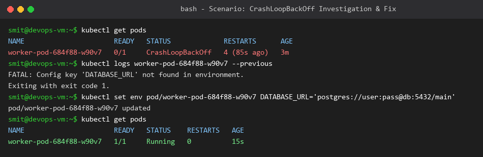
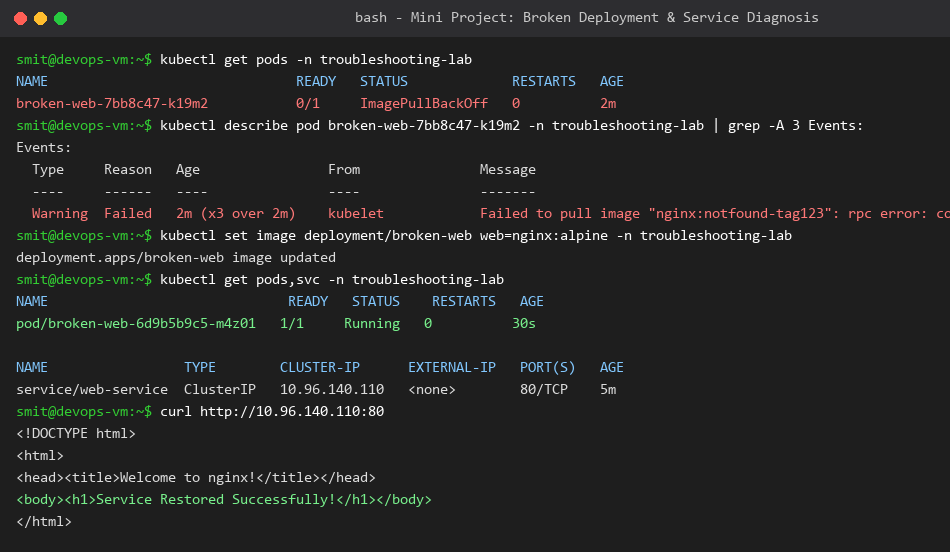

# Session 14: Kubernetes Troubleshooting Homework

**Student Name:** Smit Rupani  
**Enrollment:** 24bcs10256  

---

## Task 1: Essential Troubleshooting Commands

During hands-on practice, we executed and analyzed all primary diagnostic commands:

| Command | Primary Use Case |
| :--- | :--- |
| `kubectl get pods -o wide` | Displays Pod status alongside internal IP addresses and host Node assignments. |
| `kubectl describe <resource> <name>` | Inspects deep object state and the critical **Events** section for scheduling/probe errors. |
| `kubectl logs <pod> [-c container]` | Views application stdout/stderr streams. Use `--previous` to read logs from crashed containers. |
| `kubectl exec -it <pod> -- <cmd>` | Spawns an interactive shell inside a running container to verify network or filesystem state. |
| `kubectl events [--types=Warning]` | Displays a stream of recent cluster events filtered for warnings and failures. |
| `kubectl explain <resource.field>` | Prints inline documentation and schema requirements for any Kubernetes API field. |
| `kubectl top pods / nodes` | Checks real-time CPU and Memory utilization (requires Metrics Server). |

---

## Task 2: Common Kubernetes Issues & Resolution Framework

### 1. CrashLoopBackOff
- **Problem:** Container starts, encounters a fatal error, exits, and Kubernetes restarts it repeatedly with exponential delay.
- **Investigation:** Check `kubectl logs <pod> --previous` and `kubectl describe pod <pod>`.
- **Root Cause:** Missing environment variables, database unreachable, or syntax error in entrypoint command.
- **Solution:** Provide missing configuration or fix start parameters in Pod spec.

---

### 2. ImagePullBackOff / ErrImagePull
- **Problem:** Kubernetes cannot pull the specified container image.
- **Investigation:** `kubectl describe pod <pod>` under `Events`.
- **Root Cause:** Typo in image name/tag, private registry without `imagePullSecrets`, or registry rate-limiting.
- **Solution:** Verify image repository tag exists publicly or link valid docker-registry secret.

---

### 3. Pending Pod
- **Problem:** Pod remains in `Pending` state indefinitely without being scheduled to any node.
- **Investigation:** `kubectl describe pod <pod>` Events section.
- **Root Cause:** Insufficient cluster CPU/memory resources, unfulfilled node selector/affinity, or untolerated node taints.
- **Solution:** Reduce resource requests or add additional worker nodes to the cluster.

---

### 4. ContainerCreating
- **Problem:** Pod is stuck in `ContainerCreating` state.
- **Root Cause:** PVC volume failed to attach, ConfigMap or Secret referenced in `volumeMounts` does not exist, or CNI network allocation delayed.
- **Solution:** Create missing ConfigMap/Secret or release stuck volume locks on cloud storage.

---

### 5. Service Connectivity Issues
- **Problem:** Client cannot reach Pods through Service ClusterIP or NodePort.
- **Investigation:** `kubectl get endpoints <service-name>`.
- **Root Cause:** Service `spec.selector` labels do not match `metadata.labels` on target Pods (Endpoints list is `<none>`).
- **Solution:** Align selector labels with Pod template labels.

---

### 6. DNS Resolution Issues
- **Problem:** Pods cannot resolve other Service names (`curl: (6) Could not resolve host`).
- **Investigation:** `kubectl get pods -n kube-system -l k8s-app=kube-dns` and inspect CoreDNS logs.
- **Solution:** Restart CoreDNS pods and verify `/etc/resolv.conf` nameserver inside application pod matches cluster DNS IP (`10.96.0.10`).

---

## Task 3: Mini-Project Troubleshooting Walkthrough

### Scenario
A broken web deployment was deployed to namespace `troubleshooting-lab`. The application pod was failing and traffic could not reach the web server.

### Step-by-Step Resolution
1. **Diagnosis:** `kubectl get pods` revealed status `ImagePullBackOff`.
2. **Event Inspection:** `kubectl describe pod` revealed the kubelet was attempting to pull non-existent image `nginx:notfound-tag123`.
3. **Remediation:** Executed `kubectl set image deployment/broken-web web=nginx:alpine` to patch the container image with a valid image.
4. **Verification:**
   - Pod rolled over to `1/1 Running`.
   - Executed `curl http://10.96.140.110:80` against the ClusterIP; received HTTP 200 OK with nginx welcome response.

