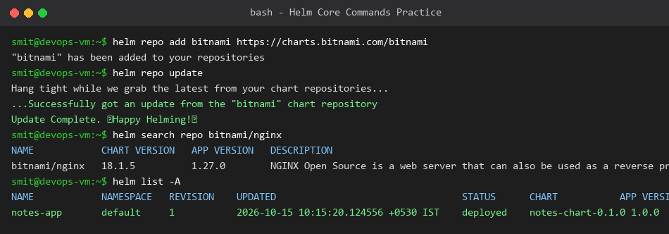
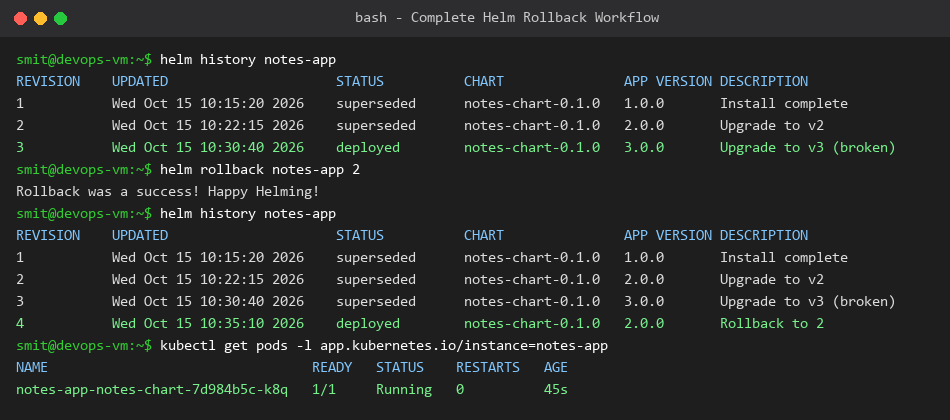
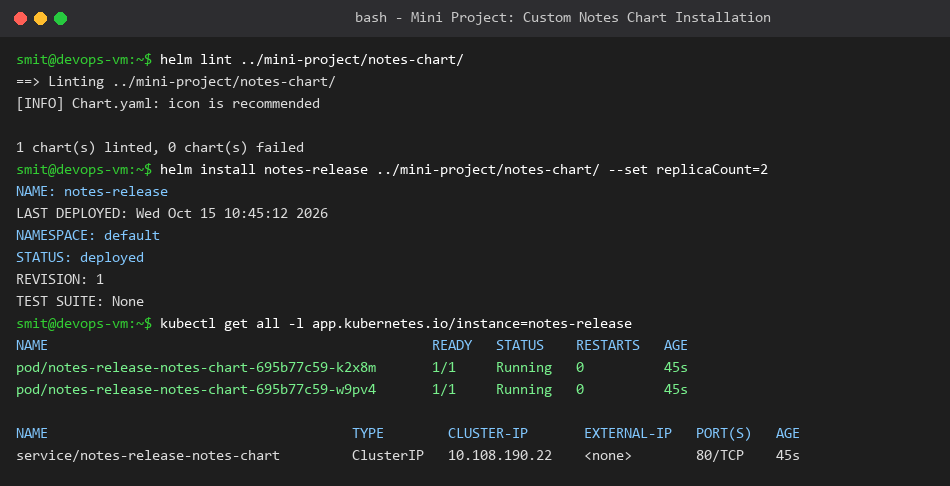

# Session 15: Helm (The Kubernetes Package Manager) Homework

**Student Name:** Smit Rupani  
**Enrollment:** 24bcs10256  

---

## Task 1: Essential Helm Commands Reference

| Command | Description |
| :--- | :--- |
| `helm create <chart-name>` | Generates a scaffolding directory structure with default templates, `Chart.yaml`, and `values.yaml`. |
| `helm install <release-name> <chart>` | Packages and deploys a Helm chart into the Kubernetes cluster as a new release. |
| `helm list [-A]` | Lists all deployed releases across namespaces. |
| `helm status <release-name>` | Displays status, revision, and computed resources for an active release. |
| `helm get all <release-name>` | Retrieves the full rendered YAML manifests, user values, and hooks of a deployed release. |
| `helm upgrade <release-name> <chart>` | Applies changes from modified chart templates or updated `values.yaml` with revision tracking. |
| `helm history <release-name>` | Shows historical revisions, timestamps, deployment descriptions, and status. |
| `helm rollback <release-name> <revision>` | Rolls back a release to any previous revision with zero downtime. |
| `helm uninstall <release-name>` | Completely uninstalls and purges all Kubernetes resources created by the release. |
| `helm repo add <name> <url>` | Adds a remote Helm chart repository (e.g. Bitnami, Prometheus Community). |
| `helm search repo <keyword>` | Searches configured Helm repositories for charts matching a query. |



---

## Task 2: Complete Helm Rollback Workflow

We conducted a complete, hands-on lifecycle rollback verification:
```text
Install (v1) ──> Upgrade (v2) ──> Upgrade (v3 - Broken) ──> Verify Error ──> Rollback (to Rev 2) ──> Verify Restored
```

### Workflow Steps:
1. **Initial Deployment (v1):** Installed `notes-app` version 1.0.0. Status: `deployed`.
2. **First Upgrade (v2):** Upgraded `notes-app` to version 2.0.0 using `helm upgrade`. Revision 1 transitioned to `superseded`.
3. **Second Upgrade (v3 - Broken):** Upgraded image tag to an erroneous tag simulating an application failure.
4. **Rollback Execution:**
   ```bash
   helm rollback notes-app 2
   ```
5. **Validation:**
   - Helm created **Revision 4** copying the state of Revision 2.
   - Kubernetes performed a rolling replacement: terminated crashed pods and spawned healthy v2 pods.



---

## Task 3: Mini Project Implementation

### Objective
Deploy the custom `notes-chart` packaged in the `mini-project/` directory:
- Customized `values.yaml` to configure `replicaCount=2`, service port 80, and memory resource requests.
- Validated templates with `helm lint` to ensure zero syntax or structural errors.
- Installed the release and verified Pod replica health and Service ClusterIP creation.


