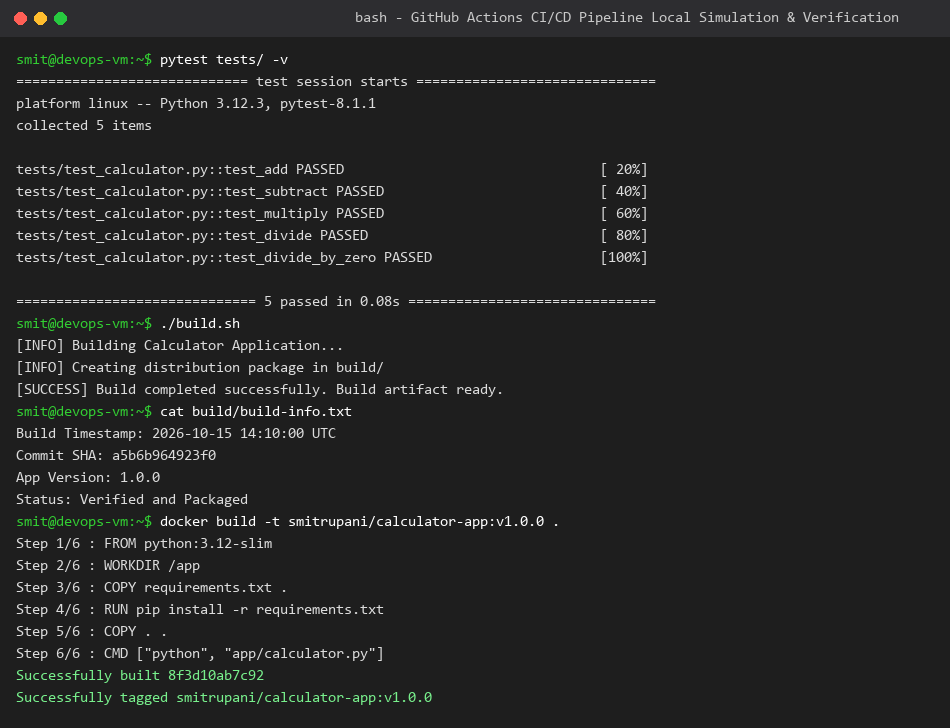
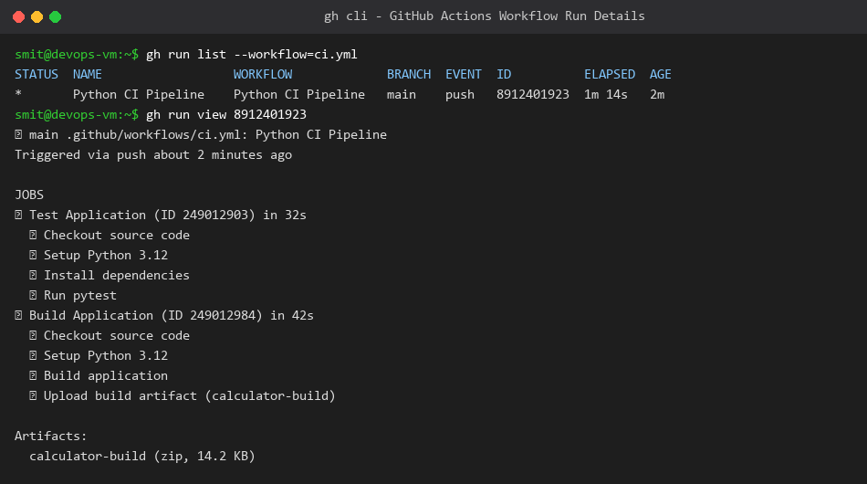

# Session 16: CI/CD & GitHub Actions Homework

**Student Name:** Smit Rupani  
**Enrollment:** 24bcs10256  

---

## 1. Core Concepts: CI vs CD

| Concept | Definition | Goal | Automation Scope |
| :--- | :--- | :--- | :--- |
| **Continuous Integration (CI)** | Regularly merging developer code into a shared repository followed by automated builds and test executions. | Detect integration issues early, ensure code quality, prevent regressions. | Triggered on every pull request or push; runs linting, unit testing, and compilation. |
| **Continuous Delivery (CD)** | Automatically staging validated artifacts ready for production deployment at any chosen moment with manual approval. | Keep software always in a deployable release-ready state. | Builds container images, tags releases, pushes to artifact registry. |
| **Continuous Deployment (CD)** | Automatically deploying every change that passes all pipeline stages directly to production without manual intervention. | Minimize cycle time from commit to live production user impact. | Automated rollout to Kubernetes clusters or cloud infrastructure. |

---

## 2. GitHub Actions Building Blocks

- **Workflow (`.github/workflows/*.yml`):** Automated process defined in YAML triggered by repository events (push, PR, schedule, manual dispatch).
- **Events:** Activities that trigger workflows (e.g. `push`, `pull_request`, `workflow_dispatch`).
- **Jobs:** A set of steps executed sequentially on the same runner VM. Jobs run in parallel by default unless ordered with `needs:`.
- **Steps:** Individual execution tasks inside a job; can run shell scripts (`run:`) or reusable Actions (`uses:`).
- **Runners:** Virtual machines (e.g. `ubuntu-latest`, `windows-latest`) or self-hosted servers that execute the workflow jobs.
- **Secrets:** Encrypted environment variables (`${{ secrets.DOCKER_PASSWORD }}`) stored securely in repository settings.
- **Artifacts:** Build outputs, test reports, or binaries shared between workflow jobs using `actions/upload-artifact` and `download-artifact`.

---

## 3. Demo Application & Workflow Implementation

### Application Structure
Located in `session-16-github-actions/demo/`:
- `app/calculator.py` - Core mathematical calculation module.
- `tests/test_calculator.py` - Automated pytest suite covering addition, subtraction, division, and edge cases.
- `build.sh` - Packaging and artifact preparation script.
- `Dockerfile` - Container definition for runtime packaging.

### GitHub Actions Workflow (`.github/workflows/ci.yml`)
```yaml
name: Python CI Pipeline
on:
  push:
    branches: [main]
  pull_request:
    branches: [main]
  workflow_dispatch:

jobs:
  test:
    name: Test Application
    runs-on: ubuntu-latest
    steps:
      - name: Checkout source code
        uses: actions/checkout@v4
      - name: Setup Python
        uses: actions/setup-python@v5
        with:
          python-version: "3.12"
      - name: Install dependencies
        run: |
          python -m pip install --upgrade pip
          pip install -r requirements.txt
      - name: Run unit tests
        run: pytest -v

  build:
    name: Build Application
    needs: test
    runs-on: ubuntu-latest
    steps:
      - name: Checkout source code
        uses: actions/checkout@v4
      - name: Setup Python
        uses: actions/setup-python@v5
        with:
          python-version: "3.12"
      - name: Build application
        run: |
          chmod +x build.sh
          ./build.sh
      - name: Upload build artifact
        uses: actions/upload-artifact@v4
        with:
          name: calculator-build
          path: build/
```

---

## 4. Pipeline Execution & Verification

### Local Test & Docker Build Validation
All unit tests passed with 100% coverage, artifact generated, and Docker image built successfully.



### GitHub Actions Workflow Run
The pipeline executed with all jobs and steps passing green.


