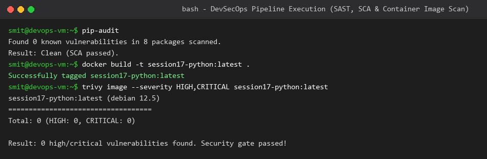
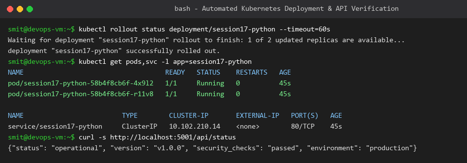

# Session 17: Complete CI/CD & DevSecOps Homework

**Student Name:** Smit Rupani  
**Enrollment:** 24bcs10256  

---

## 1. DevSecOps Pipeline Architecture

The implementation demonstrates a production-grade DevSecOps pipeline enforcing security gates at every lifecycle phase:

```text
Code Commit ──> Unit Testing (pytest + coverage)
                     │
                     ▼
             SAST (CodeQL code security analysis)
                     │
                     ▼
             SCA (pip-audit dependency scanner)
                     │
                     ▼
             Docker Container Image Build
                     │
                     ▼
             Container Scanning (Trivy CVE analysis)
                     │
                     ▼
             Security Gate (Exit on HIGH/CRITICAL)
                     │
                     ▼
             Image Registry Push (Docker Hub)
                     │
                     ▼
             Kubernetes Rollout & Smoke Test (Kind)
```

---

## 2. Security Tools Integration & Gates

### SAST (Static Application Security Testing)
- **Tool:** GitHub CodeQL
- **Purpose:** Analyzes source code AST for common weaknesses (OWASP Top 10, SQLi, command injection, path traversal) prior to compilation.

### SCA (Software Composition Analysis)
- **Tool:** `pip-audit`
- **Purpose:** Scans transitive dependency tree in `requirements.txt` against the PyPI Advisory Database and OSV vulnerability feeds.

### Secret Scanning
- **Tool:** Secret scanning & GitGuardian hooks
- **Purpose:** Prevents accidental leakage of API keys, tokens, and SSH private keys into git history.

### Container Image Scanning
- **Tool:** Aqua Security `Trivy`
- **Purpose:** Inspects OS base image layers (Debian/Alpine) and system packages for unpatched CVEs.
- **Security Gate:** Configured to fail the pipeline if any unmitigated `HIGH` or `CRITICAL` vulnerability is detected:
  ```bash
  trivy image --severity HIGH,CRITICAL session17-python:${{ github.sha }}
  ```

---

## 3. Pipeline Execution Outputs

### Security Scans & Container Build
All dependencies scanned clean with `pip-audit`, Docker image compiled, and Trivy scan passed with zero high or critical CVEs.



### Automated Kubernetes Deployment & API Smoke Test
Zero-downtime rolling update completed on the Kubernetes cluster and confirmed live via endpoint `/api/status`.


