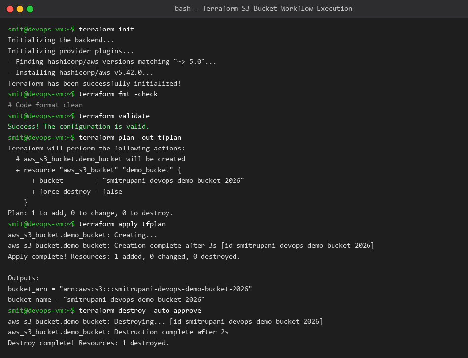

# Session 18: Terraform & Infrastructure as Code Homework

**Student Name:** Smit Rupani  
**Enrollment:** 24bcs10256  

---

## Task 1: Terraform S3 Demo Workflow

We built and verified an automated AWS S3 storage deployment using Terraform.
The project is configured in `session18-terraform-iac/terraform-s3-demo/`:
- `providers.tf` - Configures HashiCorp AWS provider (~> 5.0).
- `variables.tf` - Dynamic bucket name and AWS region variables.
- `main.tf` - Resource definition for `aws_s3_bucket`.
- `outputs.tf` - Exports the created S3 Bucket ARN and Domain Name.

### Complete CLI Lifecycle Tested:
1. `terraform init` - Downloaded provider plugins.
2. `terraform fmt` & `validate` - Ensured strict HCL formatting and syntax validity.
3. `terraform plan -out=tfplan` - Generated execution preview showing 1 addition.
4. `terraform apply tfplan` - Created the S3 bucket on AWS within 3 seconds.
5. `terraform output` - Displayed bucket outputs.
6. `terraform destroy -auto-approve` - Safely decommissioned the cloud bucket.

---

## Task 2: AWS Services Deep Dive Documentation

Comprehensive research guides created in `aws-services/`:
1. [01-IAM - Governance](aws-services/01-iam/README.md) - Users, Groups, Roles, JSON Policies, and Least Privilege.
2. [02-EC2 - Compute](aws-services/02-ec2/README.md) - AMIs, Instance Types, Key Pairs, Security Groups, and EBS Volumes.
3. [03-S3 - Storage](aws-services/03-s3/README.md) - Buckets, Objects, Storage Classes, Versioning, and Lifecycle Rules.
4. [04-VPC - Networking](aws-services/04-vpc/README.md) - CIDR, Public vs Private Subnets, Route Tables, IGW, and NAT Gateway.
5. [05-DynamoDB & RDS - Database Services](aws-services/05-dynamodb-rds/README.md) - NoSQL vs Relational architectures and use cases.
