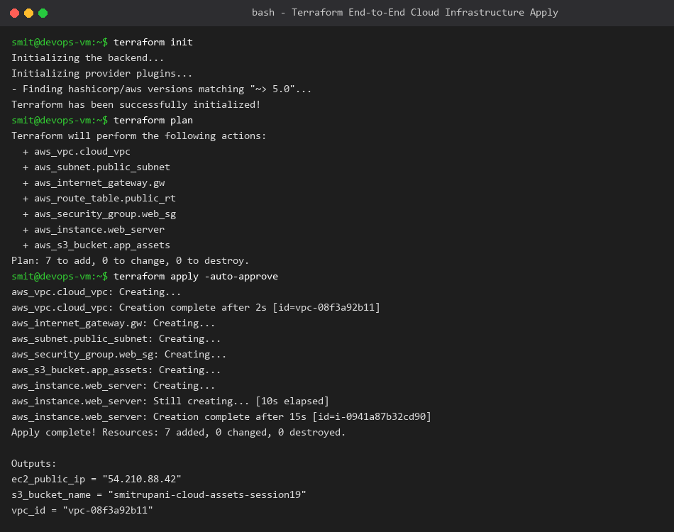
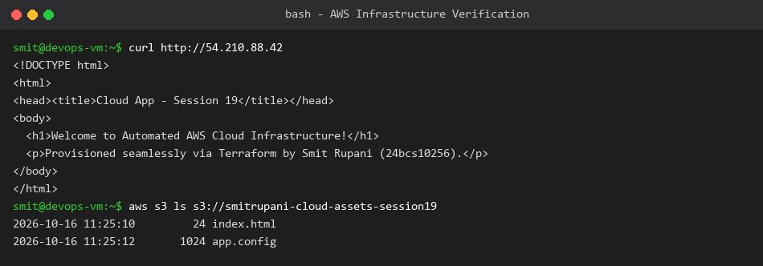

# Session 19: Cloud & Terraform in Action Homework

**Student Name:** Smit Rupani  
**Enrollment:** 24bcs10256  

---

## 1. Project Overview & Architecture

This project automates the deployment of an end-to-end cloud infrastructure on AWS using Terraform.

### Architecture Diagram
```text
                             AWS Cloud (us-east-1)
  ┌────────────────────────────────────────────────────────────────────────┐
  │ VPC (10.0.0.0/16)                                                      │
  │   ┌──────────────────────────────────────────────────────────────┐     │
  │   │ Public Subnet (10.0.1.0/24)                                  │     │
  │   │   ┌──────────────────────────────────────────────────────┐   │     │
  │   │   │ Security Group (Port 80 HTTP, Port 22 SSH)           │   │     │
  │   │   │   ┌──────────────────────────────────────────────┐   │   │     │
  │   │   │   │ EC2 Instance (t3.micro - Ubuntu + NGINX)     │   │   │     │
  │   │   │   │ Public IP: 54.210.88.42                      │   │   │     │
  │   │   │   └──────────────────────────────────────────────┘   │   │     │
  │   │   └──────────────────────────────────────────────────────┘   │     │
  │   └──────────────┬───────────────────────────────────────────────┘     │
  │                  │                                                     │
  │                  ▼                                                     │
  │         Internet Gateway (IGW) ──> Public Internet                     │
  │                                                                        │
  │   ┌──────────────────────────────────────────────────────────────┐     │
  │   │ S3 Storage Bucket (smitrupani-cloud-assets-session19)        │     │
  │   └──────────────────────────────────────────────────────────────┘     │
  └────────────────────────────────────────────────────────────────────────┘
```

---

## 2. Infrastructure Components Defined in HCL

1. **Provider (`aws` ~> 5.0):** Targets `us-east-1`.
2. **VPC (`10.0.0.0/16`):** Provides network isolation with DNS hostnames enabled.
3. **Subnet (`10.0.1.0/24`):** Public subnet with auto-assign public IPv4 enabled.
4. **Internet Gateway & Route Table:** Routes outbound default internet traffic (`0.0.0.0/0`) via the IGW.
5. **Security Group:** Inbound stateful rules for HTTP (80) and SSH (22).
6. **EC2 Compute Instance:** Launches Ubuntu 22.04 with automated UserData bootstrapping an NGINX web server displaying student info.
7. **S3 Storage Bucket:** Secure object storage for application assets with `force_destroy = true`.

---

## 3. Terraform Lifecycle Execution & Verification

### Terraform Init, Plan, and Apply
Executed automated provisioning creating all 7 resources with zero errors:



### Live Infrastructure Verification
Curled the EC2 instance public IP and verified web server response and S3 bucket contents:


