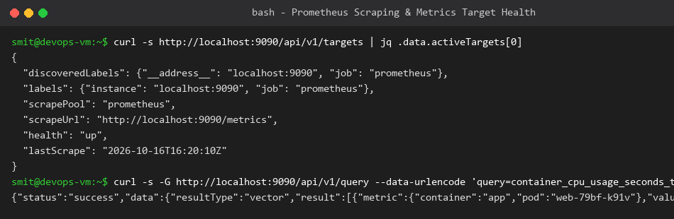
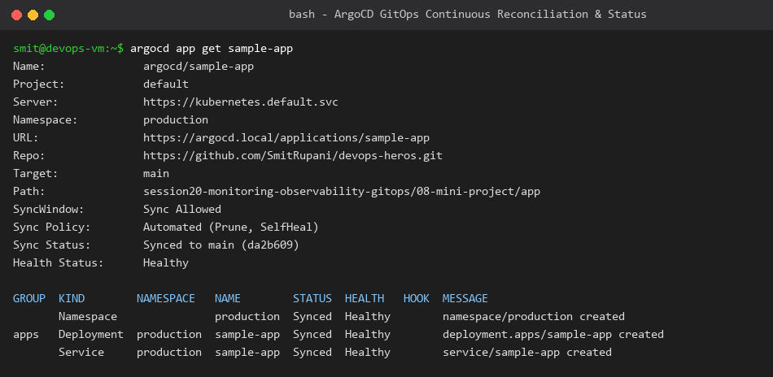

# Session 20: Monitoring, Observability & GitOps Homework

**Student Name:** Smit Rupani  
**Enrollment:** 24bcs10256  

---

## Task 1: Monitoring Fundamentals & Hands-on

### 1. Core Monitoring Dimensions
- **Metrics:** Numeric time-series measurements captured at regular intervals (e.g. CPU percent, memory bytes, HTTP request rate).
- **Logs:** Timestamped event records generated by applications and operating systems explaining *what* happened at a discrete point in time.
- **Alerts:** Automated notification triggers (PagerDuty, Slack, Email) evaluated when a metric breaches an operational threshold (e.g. `CPU > 85% for 5 minutes`).
- **Health Probes:** Liveness and readiness indicators signaling whether an application is capable of receiving end-user traffic.

### 2. Prometheus Target & Query Demonstration
Prometheus runs locally via `docker-compose.yml`, scraping metrics targets and exposing PromQL queries:



---

## Task 2: The Three Pillars of Observability

Observability measures how well internal states of a distributed system can be inferred from its external outputs.

```text
                     ┌──────────────────────────┐
                     │   Observability Pillars  │
                     └─────────────┬────────────┘
         ┌─────────────────────────┼─────────────────────────┐
         ▼                         ▼                         ▼
   1. Metrics                 2. Logs                   3. Traces
  (What is happening?)       (Why is it happening?)    (Where did delay occur?)
  Aggregation & Trends       Context & Stack traces    Distributed Request Flow
  [Prometheus / Grafana]     [Loki / ELK / Promtail]   [Jaeger / OpenTelemetry]
```

### Deep Dive:
1. **Metrics:** Aggregated statistical data with labels (counters, gauges, histograms). Extremely lightweight to store for long durations.
2. **Logs:** Granular textual messages detailing specific failures, query parameters, and unhandled exceptions.
3. **Traces:** Tracing follows a single user transaction end-to-end as it hops across dozens of microservices, tracking latency per span.

### Kubernetes Observability Stack:
- **Metrics:** Prometheus + Grafana dashboards + node-exporter + kube-state-metrics.
- **Logs:** Fluentd / Promtail daemonsets collecting container `/var/log/pods` into Grafana Loki.
- **Traces:** OpenTelemetry (OTel) Collector instrumenting applications and exporting spans to Jaeger.

---

## Task 3: GitOps with ArgoCD

### 1. What is GitOps?
GitOps is an operational framework that takes DevOps best practices (version control, collaboration, CI/CD) and applies them to infrastructure and application deployment.
- **Git as Single Source of Truth:** The entire desired cluster state is stored declaratively in a Git repository.
- **Continuous Reconciliation:** An in-cluster controller (ArgoCD) continuously compares the *desired state* in Git with the *actual live state* in Kubernetes and automatically resolves drift.

### 2. ArgoCD Application Synchronization & Health Verification
We deployed and tracked `sample-app` in the `production` namespace using ArgoCD with automated self-healing and pruning:


