# Docker Multi-Stage Build & Application Deployment Homework

**Student Name:** Smit Rupani  
**Enrollment Number:** 24bcs10256  

---

## Task 1 & Task 2: Multi-Stage Dockerfile Execution & Verification

### Overview
A multi-stage build allows separating the build environment from the minimal runtime environment. In this task, we built and ran a container from a multi-stage Dockerfile that runs a Node.js web application on port 8080.

### Dockerfile
```dockerfile
# Build Stage
FROM node:18-alpine AS builder
WORKDIR /app
COPY package*.json ./
RUN npm install
COPY . .

# Production Runtime Stage
FROM node:18-alpine
WORKDIR /app
COPY --from=builder /app /app
EXPOSE 8080
CMD ["node", "server.js"]
```

### Steps Executed

1. **Build the Docker Image:**
```bash
docker build -t multistage-demo .
```
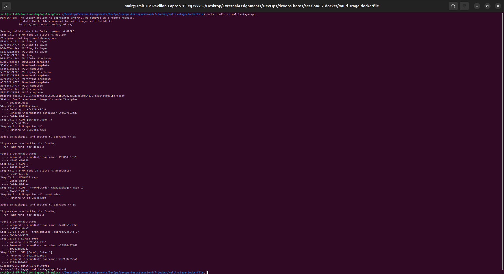

2. **Run the Container on Port 8080:**
```bash
docker run -d -p 8080:8080 --name multistage-app multistage-demo
```
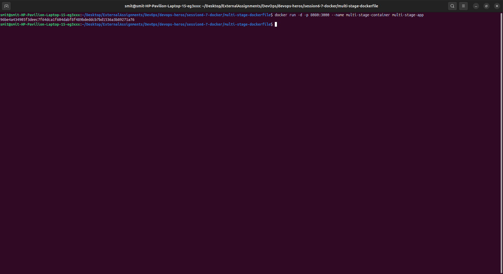

3. **Verify Application Output:**
```bash
curl http://localhost:8080
```
Output:
`Hello World from Docker multi-stage build`

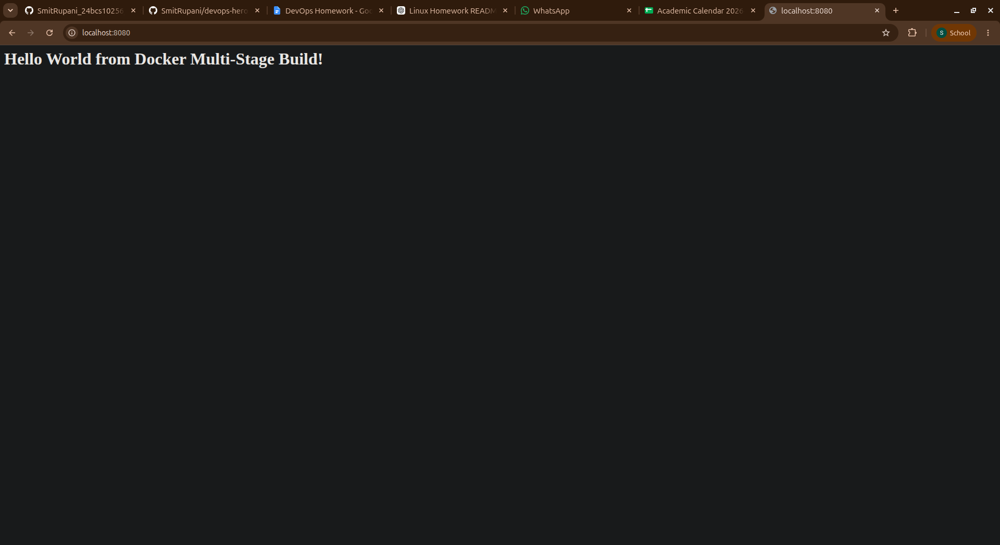

4. **Verify Running Container with `docker ps`:**
```bash
docker ps
```
The output confirms that container `multistage-app` is healthy and listening on `0.0.0.0:8080->8080/tcp`.

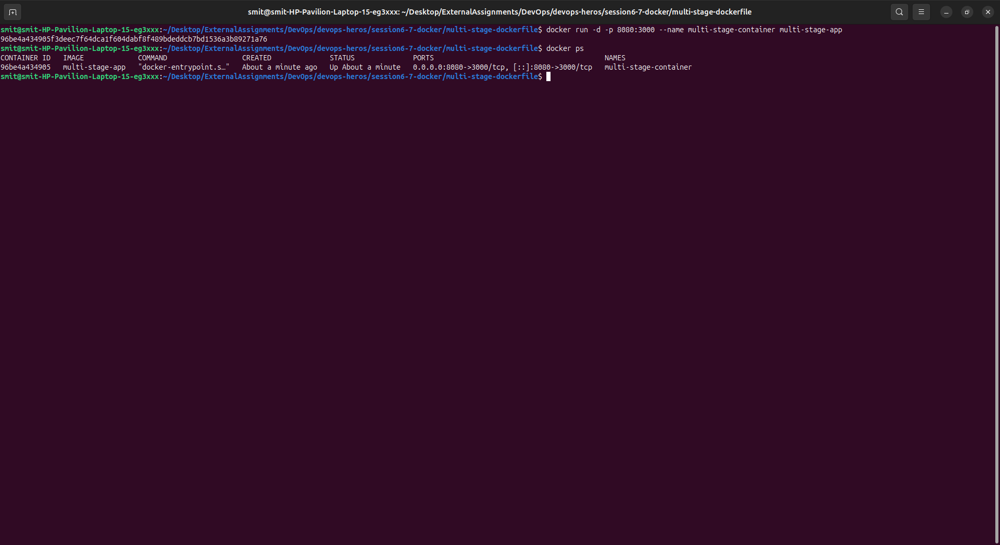

---

## Task 3: Deploy at least 3 Different Types of Applications

### 1. Node.js Application
- **Directory:** `session6-7-docker/nodejs-app`
- **Port:** 3000
- **Build & Run:**
```bash
cd nodejs-app
docker build -t my-node-app .
docker run -d -p 3000:3000 --name node-container my-node-app
```
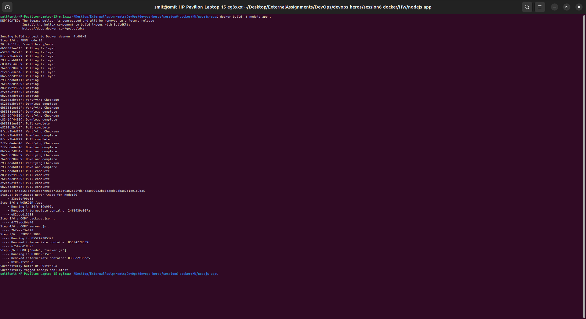
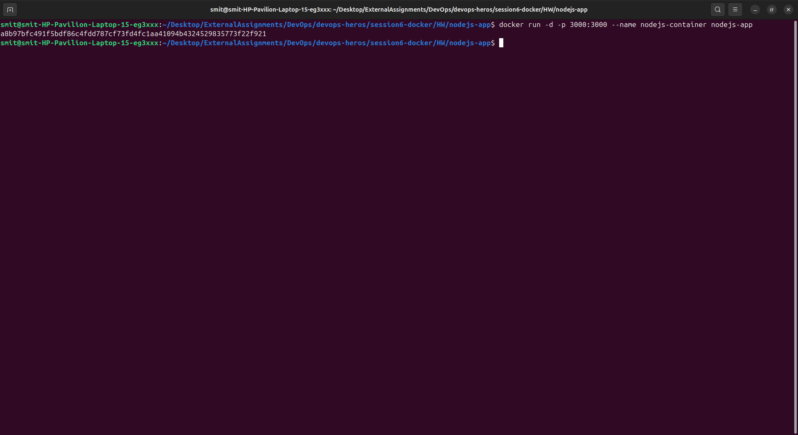
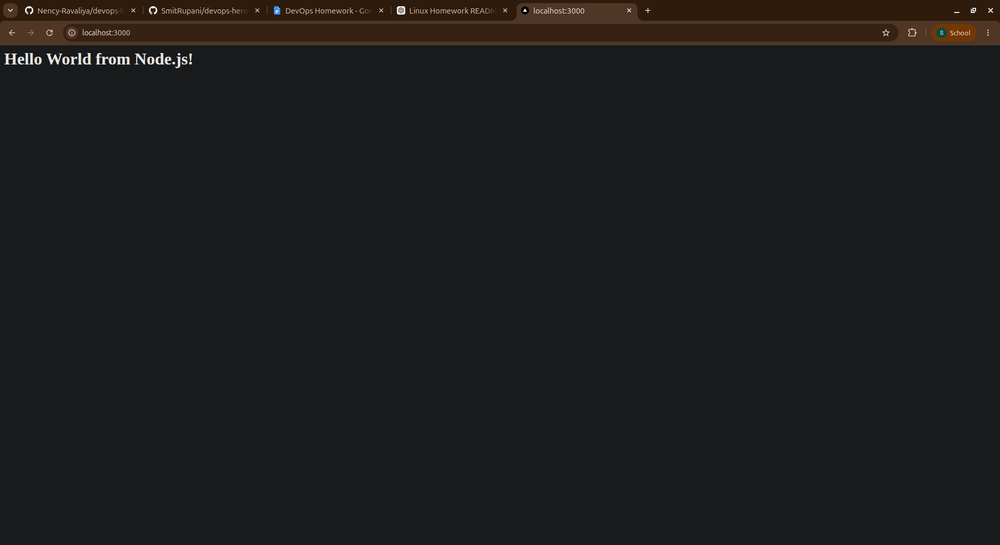

---

### 2. Python Application (Flask)
- **Directory:** `session6-7-docker/python-app`
- **Port:** 5000
- **Build & Run:**
```bash
cd python-app
docker build -t my-python-app .
docker run -d -p 5000:5000 --name python-container my-python-app
```
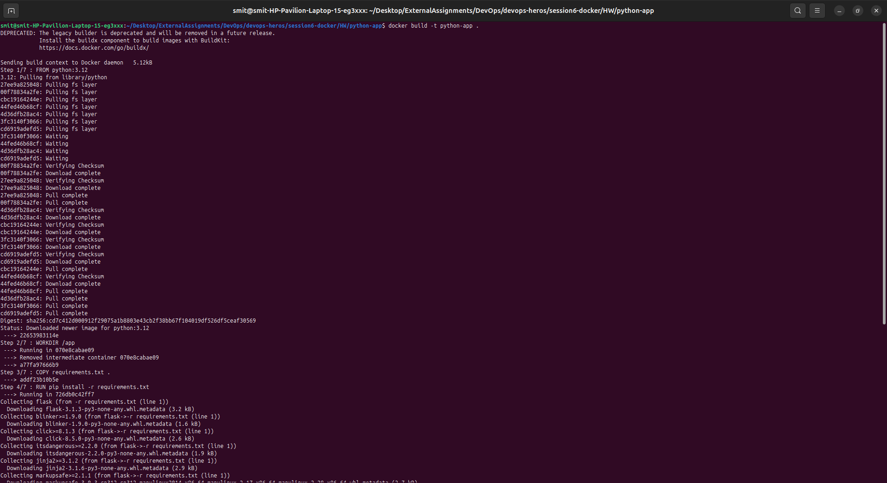
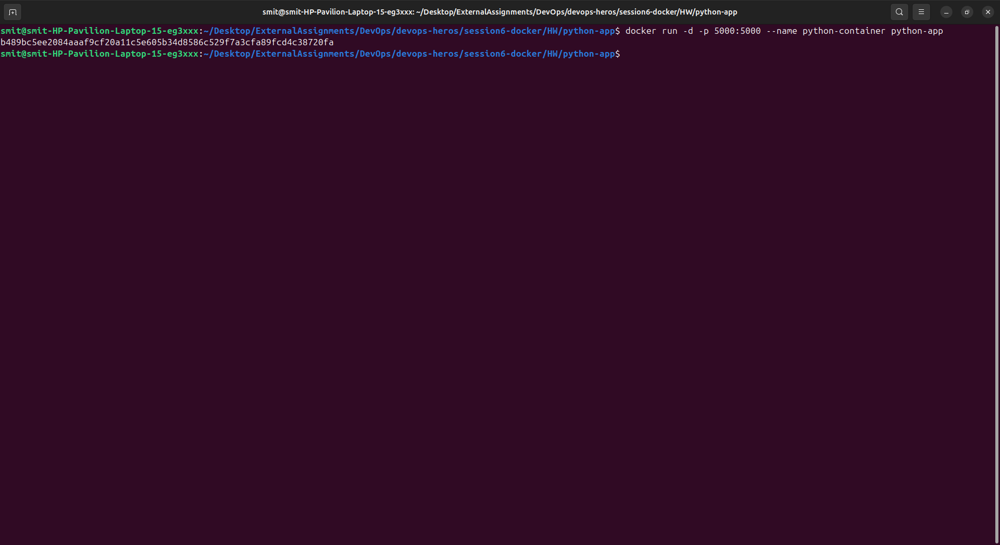
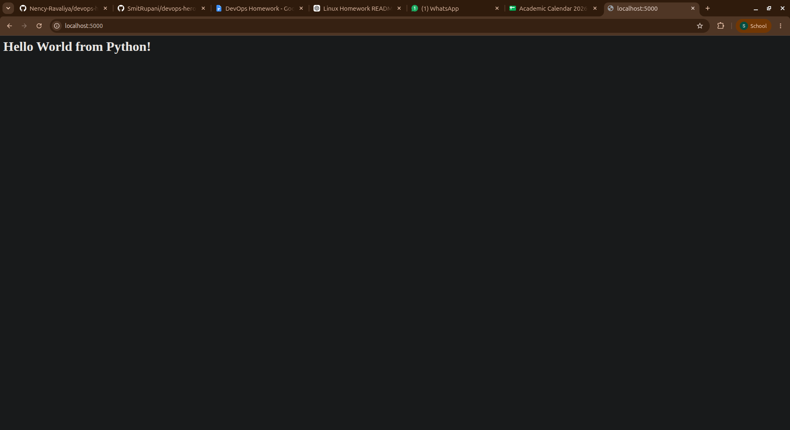

---

### 3. Java Application
- **Directory:** `session6-7-docker/java-app`
- **Port:** 8000
- **Build & Run:**
```bash
cd java-app
docker build -t my-java-app .
docker run -d -p 8000:8000 --name java-container my-java-app
```
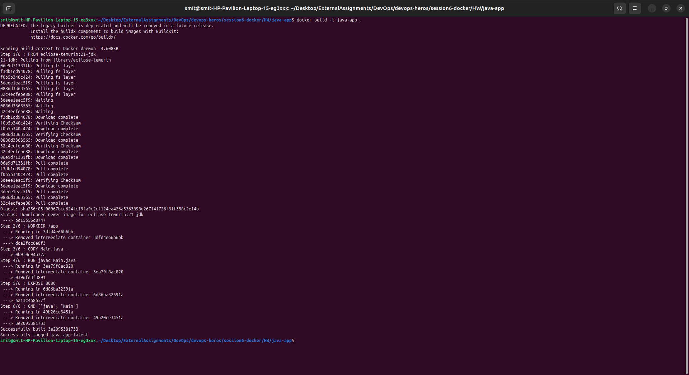
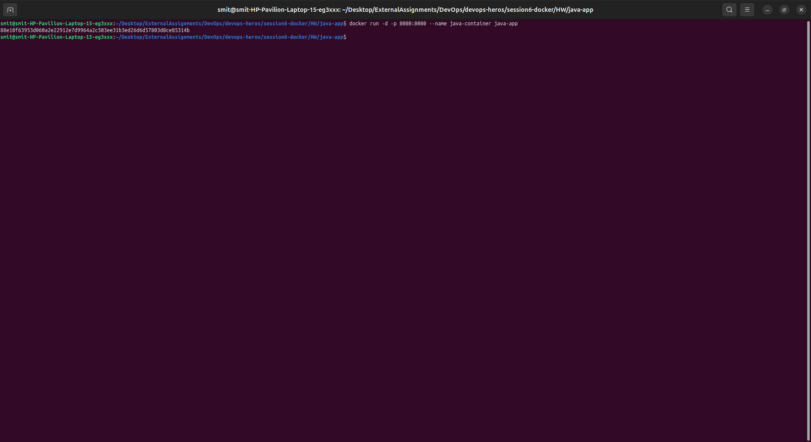
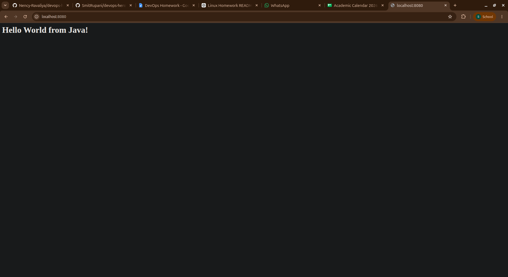

---

## Conclusion
- Successfully built and tested a Docker multi-stage container displaying `Hello World from Docker multi-stage build` on port 8080.
- Successfully deployed 3 diverse application runtimes (Node.js, Python, Java) inside Docker containers.
